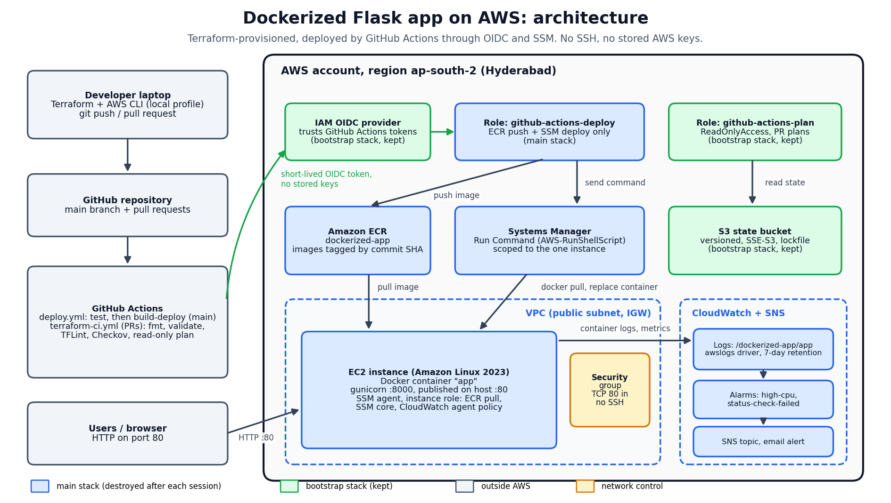
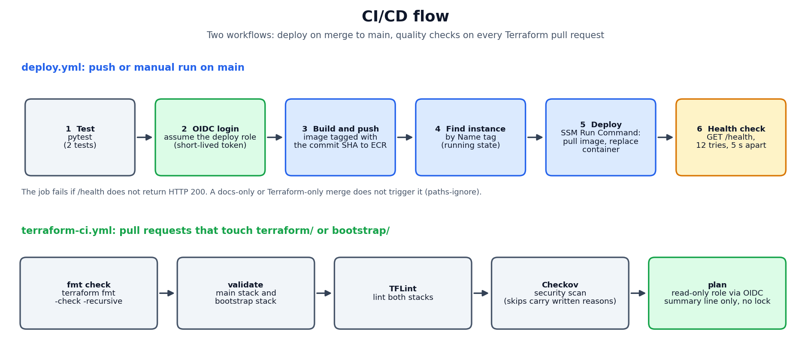

# Dockerized Flask app on AWS: Terraform + GitHub Actions CI/CD

A small Flask web app, packaged in Docker and run on AWS in Hyderabad (`ap-south-2`). Terraform builds the infrastructure, GitHub Actions deploys it without stored AWS keys (OIDC) and without SSH (SSM Run Command), and CloudWatch monitors it. Two planned failure tests are written up as incident reports.

I built it to practise the work of a cloud support or DevOps engineer: provision, deploy, monitor, break it on purpose, diagnose, fix and document.

> **The stack is destroyed after every working session to control cost.** The live app is not online, and `build-deploy` runs on `main` fail while the stack is down because the deploy role and the instance do not exist. That is expected and is not a code bug (see [Cost and teardown](#cost-and-teardown)).

## Architecture

<p align="center"></p>

<p align="center"></p>

## What it does

- **App:** a Flask service with `/` (a JSON message) and `/health` (`{"status":"ok"}`), served by gunicorn on port 8000 inside the container and published on port 80 of the instance. Two pytest tests run on every push and pull request.
- **Infrastructure (Terraform):** a VPC with one public subnet and an internet gateway, a security group that allows inbound TCP 80 only, an EC2 instance (Amazon Linux 2023, managed through SSM, no SSH), an ECR repository, IAM roles, CloudWatch logs and alarms, and an SNS email topic.
- **Deploy (GitHub Actions):** on a merge to `main`, the pipeline tests, signs in to AWS with a short-lived OIDC token, builds the image, pushes it to ECR tagged with the commit SHA, finds the instance by its `Name` tag, replaces the container through SSM Run Command, and fails the job unless `/health` returns HTTP 200.
- **Terraform checks (GitHub Actions):** every pull request that touches Terraform runs `terraform fmt`, `validate`, TFLint, Checkov and a read-only `plan`.
- **Remote state:** an S3 bucket with versioning, encryption and native locking, created by a separate `bootstrap/` stack that is never destroyed.

## Tech stack

| Area | Tools | Why |
|---|---|---|
| App | Python, Flask, gunicorn, pytest | Small and easy to test; gunicorn is a production-style server |
| Container | Docker | The same image runs locally and on the instance |
| Infrastructure as code | Terraform (S3 backend, native locking, needs 1.10 or newer) | Repeatable builds and teardowns; the plan is reviewed before every apply |
| CI/CD | GitHub Actions | Tests, image build, deploy and Terraform checks in one place |
| AWS | VPC, EC2, ECR, IAM (OIDC), Systems Manager, CloudWatch, SNS, S3 | Enough services to show networking, identity, deploy and monitoring |
| Quality | TFLint, Checkov | Catch Terraform mistakes and security gaps before apply |

## Repository layout

```text
app/                 Flask app, Dockerfile and pytest tests
terraform/           Main stack: network, security group, EC2, IAM, ECR, OIDC deploy role,
                     monitoring and the S3 backend configuration
bootstrap/           Kept stack: state bucket, GitHub OIDC provider, read-only plan role
.github/workflows/   deploy.yml and terraform-ci.yml
docs/                Deployment, monitoring, incident reports, Terraform quality notes,
                     troubleshooting log, diagrams and evidence screenshots
```

## Design decisions

- **OIDC instead of access keys.** GitHub issues a short-lived token for each run and AWS checks it against the role's trust policy. No long-lived AWS secret is stored in GitHub. The trust policy is pinned to this repository and to the `main` branch for deploys.
- **SSM instead of SSH.** No port 22, no key pair to store or rotate, and every command is logged in AWS. The deploy role may run one SSM document on one instance.
- **Least privilege.** The instance can pull only from this ECR repository. The deploy role can push to ECR and run the deploy command, nothing else. Pull request plans use a separate read-only role.
- **One image tag per commit.** Each image is tagged with the commit SHA, so a rollback is a redeploy of an earlier SHA. The ECR repository itself keeps the default mutable tag setting.
- **Two Terraform stacks.** The main stack is destroyed after each session. The state bucket, OIDC provider and plan role live in `bootstrap/` so that destroying the main stack cannot delete its own state.

## How a deploy works

1. A merge to `main` (or a manual run of the workflow) starts `deploy.yml`.
2. The `test` job runs pytest.
3. `build-deploy` assumes the deploy role with an OIDC token and logs in to ECR.
4. It builds the image and pushes it, tagged with the commit SHA.
5. It looks up the running instance by its `Name` tag and sends a Run Command that pulls the image and replaces the container.
6. It requests `/health` up to 12 times, 5 seconds apart, and fails unless it gets HTTP 200.

More detail: [docs/deployment.md](docs/deployment.md).

## Evidence

Account IDs, IP addresses and access keys in every screenshot are covered with solid boxes. The full set is in the [evidence gallery](docs/evidence/README.md).

### Pipeline and deploy

<p align="center"><br><sub>Before: the app response before the pipeline change</sub></p>
<p align="center"><br><sub>A merged pull request triggers a green run: test and build-deploy both pass</sub></p>
<p align="center"><br><sub>After: the deployed container returns the new message, with no manual step</sub></p>
<p align="center"><br><sub>ECR holds images tagged with the commit SHA</sub></p>
<p align="center"><br><sub>Systems Manager sees the instance as Online, so no SSH is needed</sub></p>

### OIDC trust: the problem and the fix

The deploy role kept rejecting the GitHub token even though the secret, provider, audience and region were all correct. CloudTrail showed that the token's `sub` claim contained numeric IDs (`owner@id/repo@id`), so a condition written as plain `owner/repo` never matched. The trust policy now lists both formats and stays pinned to `main`. Full story: [troubleshooting entry 8](docs/troubleshooting.md#8-stsassumerolewithwebidentity-not-authorized-despite-correct-settings).

<p align="center"><br><sub>Before: the trust policy still held the placeholder repository name</sub></p>
<p align="center"><br><sub>After: both subject formats are accepted, pinned to the main branch</sub></p>
<p align="center"><br><sub>Least privilege at work: pushing to ECR in the wrong region (us-east-1) is denied</sub></p>

### Monitoring

CloudWatch collects the container logs and two alarms send email through SNS. Details and limits: [docs/monitoring.md](docs/monitoring.md).

<p align="center"><br><sub>Container start-up lines read with aws logs tail (request logging is not enabled)</sub></p>
<p align="center"><br><sub>High-CPU alarm: threshold 70% for 2 datapoints within 10 minutes, state OK</sub></p>
<p align="center"><br><sub>Alert email from forcing the alarm state (Manual notification test). This was not a real CPU spike</sub></p>

### Incident 1: the container is stopped (planned test)

I stopped the container with `docker stop app` through SSM, timed the outage with a script that called `/health` every 2 seconds, and wrote it up in [INCIDENT-001](docs/incidents/INCIDENT-001.md). The outage lasted about 193 seconds (last 200 at 23:04:44, first 200 after recovery at 23:07:57, IST). Neither alarm fired, because both watch the instance and the instance stayed healthy.

<p align="center"><br><sub>Baseline: /health returns ok and the container is Up</sub></p>
<p align="center"><br><sub>The monitor: 200 responses turn into FAIL after the container is stopped</sub></p>
<p align="center"><br><sub>Both alarms stay OK during the outage</sub></p>
<p align="center"><br><sub>docker stop, container Exited (0), and gunicorn shutting down cleanly on SIGTERM</sub></p>
<p align="center"><br><sub>The monitor shows FAIL returning to 200 at 23:07:57</sub></p>

### Incident 2: the HTTP rule is removed from the security group (planned test)

I removed the port 80 inbound rule with the AWS CLI, as a stand-in for a manual console change. The app kept running while the internet could not reach it. Terraform detected the drift and one `terraform apply` restored the rule. The outage lasted about 331 seconds (first failed check 16:53:40, first 200 after the fix 16:59:11, IST). Full report: [INCIDENT-002](docs/incidents/INCIDENT-002.md).

<p align="center"><br><sub>The monitor: last 200 at 16:53:38, first FAIL at 16:53:40</sub></p>
<p align="center"><br><sub>curl -v times out after 5 seconds, which points to dropped packets</sub></p>
<p align="center"><br><sub>Through SSM: container Up, port 80 listening, localhost returns 200</sub></p>
<p align="center"><br><sub>Security group rules: only the outbound rule remains</sub></p>
<p align="center"><br><sub>CloudTrail: RevokeSecurityGroupIngress at 16:53:38 IST</sub></p>
<p align="center"><br><sub>Both alarms are still OK: nothing alerts on this failure</sub></p>
<p align="center"><br><sub>terraform plan shows 1 to add: the deleted rule (drift)</sub></p>
<p align="center"><br><sub>After terraform apply recreated the rule, the monitor goes from FAIL back to 200</sub></p>

### Terraform quality checks and remote state

Details: [docs/terraform-quality.md](docs/terraform-quality.md).

<p align="center"><br><sub>Checkov on the main stack, before: 100 passed, 13 failed</sub></p>
<p align="center"><br><sub>Checkov after: 0 failed. Findings I accepted are skipped inline, each with a written reason</sub></p>
<p align="center"><br><sub>The state bucket in Hyderabad with versioning enabled</sub></p>
<p align="center"><br><sub>The plan role trusts pull request tokens only</sub></p>
<p align="center"><br><sub>All pull request checks pass: test, Terraform checks and plan. The deploy job is skipped on pull requests</sub></p>

## Troubleshooting log

Twenty real problems, each with symptom, diagnosis, root cause, fix and prevention: [docs/troubleshooting.md](docs/troubleshooting.md).

## Reproduce it

You need an AWS account, an AWS CLI profile, Terraform 1.10 or newer, and your own copy of this repository. The commands are for Windows PowerShell and use the Hyderabad region.

**1. Create the bootstrap stack (once, never destroy it).**

```powershell
$env:AWS_PROFILE = "default"
cd bootstrap
Set-Content terraform.tfvars @'
state_bucket_name = "my-dockerized-app-tfstate-7k2q9x"
github_repo       = "your-github-user/your-repo-name"
'@
terraform init
terraform apply
terraform output -raw plan_role_arn
```

Pick your own globally unique bucket name. The trust policies in `terraform/oidc.tf` and `bootstrap/main.tf` also list GitHub's numeric-ID form of the subject claim. Replace those numbers with your own owner and repository IDs (see troubleshooting entry 8).

**2. Point the main stack at the bucket and apply it.** First edit `bucket` in `terraform/backend.tf` to the bucket name from step 1, then run:

```powershell
cd ..\terraform
$env:AWS_PROFILE = "default"
Set-Content terraform.tfvars @'
aws_profile = "default"
aws_region  = "ap-south-2"
alert_email = "you@example.com"
github_repo = "your-github-user/your-repo-name"
'@
terraform init
terraform plan
terraform apply
terraform output -raw github_deploy_role_arn
```

Set `aws_region` explicitly, because the variable's default is a different region. Read the plan before you apply: the stack has no NAT gateway, load balancer or database, so stop if you see one.

**3. Add two repository secrets** under Settings, Secrets and variables, Actions: `AWS_ROLE_ARN` (the deploy role ARN from step 2) and `AWS_PLAN_ROLE_ARN` (the plan role ARN from step 1).

**4. Confirm the alert email** that SNS sends, then wait about 5 minutes for the instance to appear in Systems Manager.

```powershell
aws ssm describe-instance-information --region ap-south-2 --query "InstanceInformationList[].[InstanceId,PingStatus]" --output text
```

**5. Deploy.** In GitHub, open Actions, then CI, then Run workflow, and choose `main`. (The ECR repository is empty after every apply, so the first deploy has to build and push the image.)

**6. Check it.**

```powershell
$ip = terraform output -raw public_ip
curl.exe "http://$ip/health"
curl.exe "http://$ip/"
```

**7. Tear it down when you finish.**

```powershell
terraform destroy
terraform state list
```

`terraform state list` should print nothing. Then look in the Hyderabad console for leftover instances, volumes and Elastic IPs. Never run `terraform destroy` in `bootstrap/`.

## Cost and teardown

- One small EC2 instance (t3.micro) is the only hourly cost. I destroy the main stack at the end of every session.
- The `bootstrap/` stack (one S3 bucket and a few IAM objects) stays up.
- I chose not to use a NAT gateway, load balancer or database, because they bill by the hour and the project does not need them.
- While the main stack is destroyed, a merge that triggers `deploy.yml` fails at the credentials step because the deploy role does not exist. Docs-only and Terraform-only merges are ignored by that workflow (`paths-ignore`), so they stay quiet. The red runs in the history are expected.

## Known limits

- **One instance, no rollback automation.** A deploy briefly stops the container, so there is no zero-downtime deploy. A rollback means redeploying an earlier commit SHA.
- **Monitoring is basic.** Alarms cover CPU and EC2 status checks only. Nothing alerts when the container stops or the security group changes, and both incident tests passed without an alarm. Request logging is not enabled.
- **The alert email path was tested by forcing the alarm state**, not with a real CPU spike.
- **Pull request plans run with `-lock=false` and the AWS `ReadOnlyAccess` policy**, which is broader than strictly needed. The plan role is read-only, so it cannot write a lock.
- **Hardening changes not yet applied.** The Terraform changes for an EBS-optimised instance, a locked-down default security group and no automatic public IP on the subnet are validated and scanned, but I have not applied them yet.
- **Planned failures only.** The incident reports describe tests I injected on purpose, not production outages.

## What I learned

- A token claim can differ from the documentation. The OIDC `sub` claim carried numeric IDs, and only CloudTrail showed what AWS actually received.
- Least privilege proves itself by failing loudly: the denied ECR push in the wrong region was the policy doing its job.
- A timeout and a refused connection point to different layers (network path versus the app), and an instance-level alarm cannot see a network-path failure.
- Terraform drift is visible: `terraform plan` showed the manually deleted rule and one apply fixed it.
- Cost discipline is part of the work: plan before apply, destroy after every session, check the console for leftovers.
- Branch and folder hygiene saves hours: many of the 20 troubleshooting entries are a wrong branch, a wrong folder or a wrong name.

## AI assistance

I built this as a self-directed learning project with AI assistance (Claude) for coaching, drafting and code review. I ran and debugged every step myself, and AI-suggested changes went through the same pull request checks as everything else.
